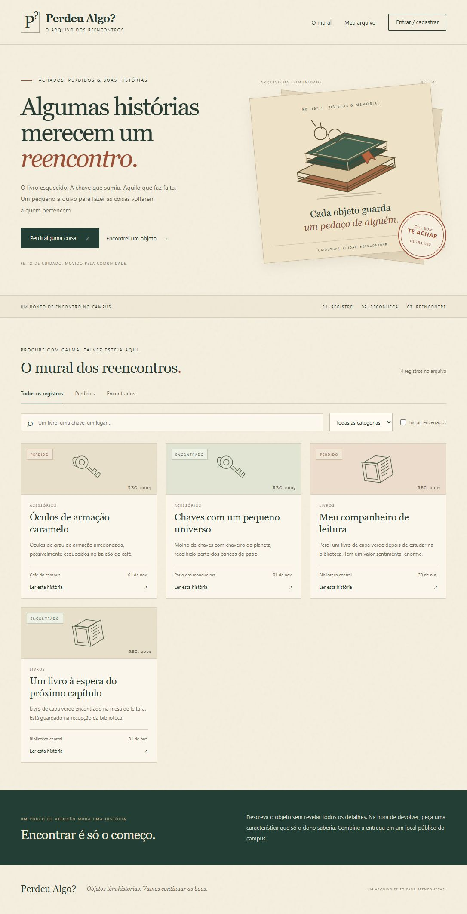
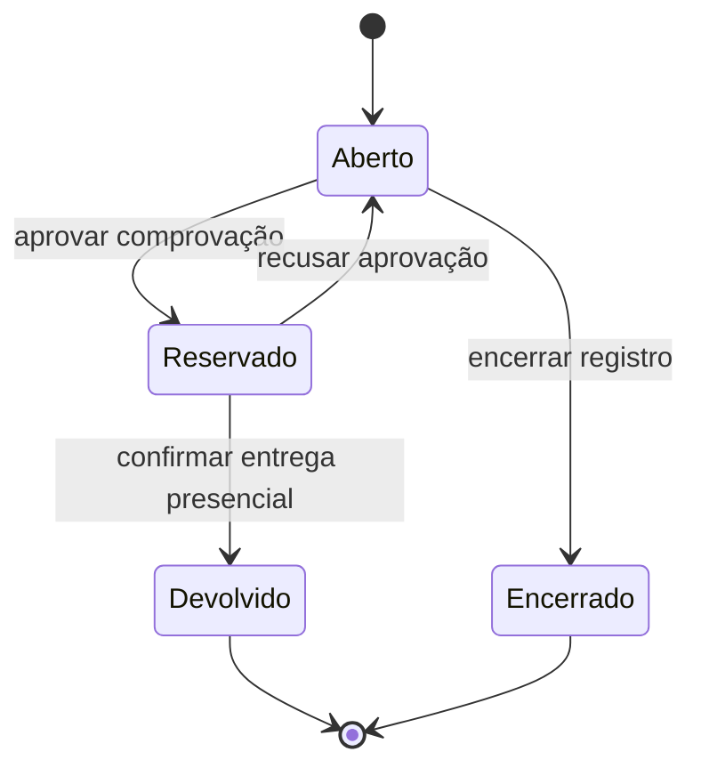

# Perdeu Algo?

**Objetos têm histórias. Vamos continuar as boas.**

Um arquivo de achados e perdidos para uma comunidade universitária, com estética de livraria antiga: papel creme, verde profundo, cobre e fichas de catálogo. Aplicação completa em **C# / ASP.NET Core 10**, **SQL / SQLite**, **HTML**, **CSS** e **JavaScript puro**.



## Executar

Pré-requisito: SDK .NET 10. Não precisa de Node, Python ou servidor de banco de dados.

Na pasta deste README:

```sh
dotnet restore PerdeuAlgo.slnx
dotnet run --project src/PerdeuAlgo -- --seed
```

Abra **http://localhost:5187**. O argumento `--seed` adiciona quatro fichas fictícias somente quando não existem registros. As contas dessas fichas têm senhas aleatórias e não são contas de acesso. Crie sua conta pela interface. Para verificar o fluxo entre pessoas, use dois navegadores ou uma janela privada com outra conta.

Sem demonstração: execute o mesmo comando sem `-- --seed`. O SQLite e as chaves de sessão são criados em `src/PerdeuAlgo/App_Data/`, excluído do Git. Os dados persistem entre reinicializações.

## O que funciona

- Cadastro, login e logout reais, com senha armazenada como hash PBKDF2 pelo `PasswordHasher` do ASP.NET Core.
- Mural público com busca textual, categorias, filtros de perdidos/encontrados e histórico de encerrados.
- Cadastro de objetos com data, local, descrição e característica oculta para encontrados.
- Área pessoal com registros, correspondências e solicitações enviadas/recebidas.
- Comprovação privada, análise pelo responsável, reserva e confirmação da entrega.
- Layout responsivo, formulários com rótulos, navegação por teclado e mensagens de erro.

## Regras de negócio

1. Um registro é `lost` (perdido) ou `found` (encontrado). Datas futuras ou anteriores a dois anos não são aceitas.
2. Encontrados precisam de uma característica oculta. Ela não aparece na listagem pública nem nas correspondências. Apenas quem cadastrou pode consultá-la pela rota protegida.
3. Somente outra pessoa pode solicitar um objeto encontrado e aberto. A comprovação precisa ter entre 10 e 600 caracteres.
4. Cada pessoa tem no máximo uma solicitação ativa por objeto. Várias pessoas podem solicitar enquanto ele estiver aberto.
5. Somente quem encontrou pode aprovar, recusar e confirmar a entrega. A conferência é humana: o sistema não informa se a tentativa acertou o segredo.
6. Aprovar reserva o objeto e recusa as demais solicitações pendentes. Transação SQL e índice único impedem duas aprovações, inclusive em concorrência.
7. Recusar uma solicitação aprovada reabre o objeto. Uma solicitação recusada pode ser refeita com nova comprovação.
8. Confirmar a entrega exige aprovação anterior. Depois disso, objeto e solicitação ficam encerrados, sem reabertura.
9. O autor pode encerrar manualmente um registro aberto; solicitações pendentes são recusadas. Uma reserva precisa ser desfeita por recusa antes de encerrar o registro.
10. Apenas solicitante e responsável veem a comprovação. E-mails e hashes nunca aparecem no mural.



## Correspondências explicáveis

O algoritmo usa apenas dados públicos, sem IA ou serviços externos. Compara registros abertos de pessoas diferentes, tipos opostos e mesma categoria. A data do encontrado deve estar entre a data da perda e os 14 dias seguintes.

| Critério | Pontos |
| --- | ---: |
| Mesma categoria | 35 |
| Encontrado até 3 dias depois da perda | 25 |
| Encontrado entre 4 e 14 dias depois | 15 |
| Mesmo local, ignorando maiúsculas e acentos | 25 |
| Palavra em comum de mais de 3 caracteres no título/descrição | 15 |

Pontuação máxima: 100. **Semelhança não é probabilidade nem prova de propriedade.** A interface apresenta os motivos da sugestão.

## Testes e integração contínua

```sh
dotnet test PerdeuAlgo.slnx --configuration Release
```

Os testes xUnit cobrem validação, datas, pontuação, autenticação, permissões, privacidade, transições, rollback e aprovações concorrentes. Os testes HTTP usam `WebApplicationFactory`, cookies reais, tokens antifalsificação e SQLite em memória, incluindo um fluxo de devolução entre duas contas. Cada teste HTTP usa seu próprio banco.

O GitHub Actions restaura, compila e executa os testes em cada push e pull request. Na eventualidade de um ambiente local restringir processos de compilação, use `dotnet test PerdeuAlgo.slnx -m:1 --disable-build-servers`.

## Organização

```text
src/PerdeuAlgo/
  Program.cs          # Rotas, sessão, antifalsificação e limites de login
  Domain.cs           # Modelos, validação e cálculo das correspondências
  Service.cs          # Casos de uso e transições de estado
  Database.cs         # Esquema SQL, comandos parametrizados e transações
  wwwroot/            # HTML, CSS, JavaScript e ilustrações SVG próprias
tests/PerdeuAlgo.Tests/
  RulesTests.cs       # Testes unitários puros
  ServiceTests.cs     # Regras com SQLite real em memória
  ApiTests.cs         # Integração HTTP
```

## API

Respostas de erro de negócio: `{ "error": "Mensagem em português." }`. Rotas privadas retornam 401 sem sessão e 403 sem permissão. Conflitos de estado retornam 409.

| Método | Rota | Acesso / finalidade |
| --- | --- | --- |
| GET | `/api/session` | Sessão, categorias e token CSRF |
| POST | `/api/register` | Cadastro e início de sessão |
| POST | `/api/login` | Início de sessão |
| POST | `/api/logout` | Encerramento de sessão |
| GET | `/api/items` | Fichas públicas, sem característica oculta |
| POST | `/api/items` | Criar registro autenticado |
| GET | `/api/items/{id}/matches` | Correspondências, apenas autor |
| GET | `/api/items/{id}/secret` | Detalhe oculto, apenas autor |
| POST | `/api/items/{id}/claims` | Enviar `{ "proof": "..." }` |
| POST | `/api/items/{id}/cancel` | Encerrar registro, apenas autor |
| GET | `/api/claims` | Solicitações das quais a pessoa participa |
| POST | `/api/claims/{id}/approve` | Aprovar, apenas responsável |
| POST | `/api/claims/{id}/reject` | Recusar, apenas responsável |
| POST | `/api/claims/{id}/deliver` | Confirmar entrega, apenas responsável |
| GET | `/health` | Verificação de disponibilidade do processo |

Para consumir a API, preserve os cookies, obtenha `csrfToken` em `/api/session` e envie-o no cabeçalho `X-CSRF-TOKEN` em todo POST. Depois de login, cadastro ou logout, obtenha um novo token. Exemplo de registro de objeto:

```json
{
  "kind": "found",
  "title": "Livro de capa verde",
  "category": "Livros",
  "location": "Biblioteca central",
  "date": "2026-11-01",
  "description": "Encontrado na mesa de leitura, ao lado da janela.",
  "secret": "Dedicatória manuscrita na primeira página."
}
```

## Decisões e limites

Aplicação de portfólio para execução em uma instância. O SQLite usa uma conexão serializada em processo e transações curtas; não é uma arquitetura para tráfego elevado ou múltiplas réplicas. O esquema inicial é criado automaticamente; alterações futuras exigem migrações versionadas.

Cookies são HttpOnly/SameSite Strict e exigem HTTPS fora de Development. Há proteção CSRF, SQL parametrizado, escape de conteúdo na interface, CSP e limite de 12 tentativas de autenticação por IP por minuto. Sob proxy reverso, configure proxies confiáveis e cabeçalhos encaminhados antes de usar o limite por IP.

Em hospedagem real, use HTTPS, volume persistente para `App_Data`, backups e permissões restritas. No Windows, as chaves são protegidas por DPAPI; no Linux, configure proteção das chaves em repouso. Comprovações e características ocultas ficam em texto no banco e são protegidas por autorização na API, não por criptografia do campo. Nunca publique o banco ou as chaves.

Não inclui recuperação de senha, verificação de e-mail, chat, fotos, notificações, moderação nem vínculo autenticado com uma faculdade. A entrega é combinada pessoalmente, fora do aplicativo; não há canal de contato embutido. O responsável é identificado como participante de cada solicitação, e a interface orienta a retirada em local público. Esses pontos são evoluções possíveis, não funcionalidades simuladas.
